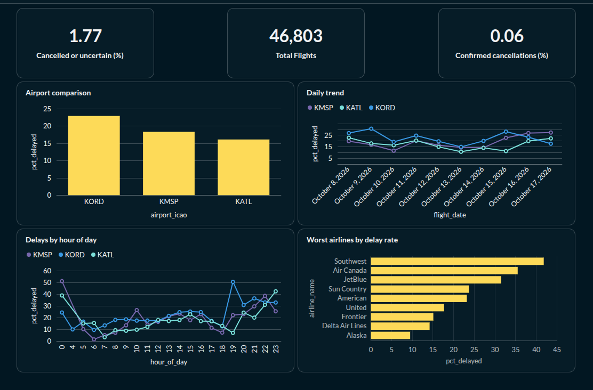

# Flight Operations Pipeline

An end-to-end ELT pipeline that ingests live flight data for three major US hubs (ORD, MSP, ATL) from the AeroDataBox API, models it with dbt, and serves delay and cancellation analytics through a Metabase dashboard. Everything runs in Docker Compose on a self-hosted Proxmox VM.



## Stack

| Layer | Tool |
|---|---|
| Orchestration | Apache Airflow 2.10 (LocalExecutor) |
| Warehouse | PostgreSQL 16 |
| Transformation and testing | dbt-postgres 1.9 |
| BI | Metabase |
| Infrastructure | Docker Compose on a Proxmox VM (Ubuntu 24.04) |

## Architecture

See [docs/architecture.md](docs/architecture.md) for the full diagram.

In short: Airflow calls the API every 12 hours (one call per airport), stores the untouched JSON in `raw`, then runs dbt to parse it into `staging` and build the `marts` that Metabase reads.

## Quick start

**Handy commands:** `make up`, `make down`, `make dbt-run`, `make dbt-test`, `make psql`

**Requirements:** Docker and Docker Compose, plus a [RapidAPI](https://rapidapi.com) key subscribed to [AeroDataBox](https://rapidapi.com/aedbx-aedbx/api/aerodatabox).

**1. Clone and configure**

```bash
git clone git@github.com:<your-username>/flight-ops-pipeline.git
cd flight-ops-pipeline
cp .env.example .env
```

Edit `.env` and set:

| Variable | Notes |
|---|---|
| `POSTGRES_PASSWORD` | Any strong password |
| `RAPIDAPI_KEY` | Your RapidAPI key |
| `AIRFLOW_ADMIN_PASSWORD` | Password for the Airflow `admin` user |
| `AIRFLOW_FERNET_KEY` | Generate with the command below |

```bash
python3 -c "import base64,os; print(base64.urlsafe_b64encode(os.urandom(32)).decode())"
```

**2. Start the stack**

```bash
docker compose build
docker compose up -d
```

First start takes a few minutes while images build and Airflow initializes its database.

**3. Create the read-only Metabase role**

```bash
docker exec -it flights-postgres psql -U warehouse -d flights -c "
CREATE ROLE metabase_ro LOGIN PASSWORD 'choose_a_password';
GRANT CONNECT ON DATABASE flights TO metabase_ro;
GRANT USAGE ON SCHEMA marts TO metabase_ro;
GRANT SELECT ON ALL TABLES IN SCHEMA marts TO metabase_ro;
ALTER DEFAULT PRIVILEGES FOR ROLE warehouse IN SCHEMA marts GRANT SELECT ON TABLES TO metabase_ro;"
```

**4. Run the pipeline**

1. Open Airflow at `http://localhost:8080` and log in as `admin`.
2. Un-pause the `flight_ingest` DAG and trigger it once manually.
3. When all tasks are green (ingest, `dbt_seed`, `dbt_run`, `dbt_test`), the `marts` schema is populated.

**5. View the dashboard**

Open Metabase at `http://localhost:3000`, create an admin account, and connect PostgreSQL with host `postgres`, port `5432`, database `flights`, and the `metabase_ro` credentials from step 3.

| Service | URL |
|---|---|
| Airflow | http://localhost:8080 |
| Metabase | http://localhost:3000 |
| Postgres | localhost:5432 |

## Future work

- **Overlapping fetch windows.** Fetch a wider range than the reporting window and dedupe, so heavily delayed flights near a window boundary aren't dropped (see Data quality finding 2).
- **Reliable departure delay.** Test whether another endpoint or a different timestamp field gives consistent gate-out times, so departure on-time performance can be reported alongside arrivals.
- **Weather join.** Add hourly weather observations per airport (for example, from NOAA METAR data) and analyze how wind, visibility, and storms relate to delay spikes like the evening at ORD on Oct 15.
- **CI.** A GitHub Actions workflow that lints SQL and runs `dbt build` against a throwaway Postgres container on every pull request.
- **Incremental models.** Move `fct_flights` to an incremental materialization as history grows, so each run processes only new windows.
- **Alerting.** Send an Airflow failure notification (email or webhook) when ingestion fails or source freshness breaks.
- **More airports.** The ingestion DAG is driven by a dictionary and the `airports` seed, so adding a hub is a two-line change plus about 4 quota units per day.
